# Branch Locator

A map-based web app for finding the nearest bank branch. A customer can search a suburb or use their location, filter by what they need (open now, branches, ATMs, cash deposits, Smart ID…), and open a location to see its hours, services, a live queue estimate for branches, and directions.

It is built with **React 19 + TypeScript** and **MapLibre GL** vector maps. This brief came without an API, so I wrote one first ([docs/API.md](docs/API.md)) and built against it. The API is mocked at the network layer with **Mock Service Worker**, so the app makes real HTTP requests that can be pointed at a real backend by changing one environment variable.

| Search and results (desktop)                                   | Branch detail (desktop)                                                          | Phone, dark mode                                                             |
| -------------------------------------------------------------- | -------------------------------------------------------------------------------- | ---------------------------------------------------------------------------- |
| 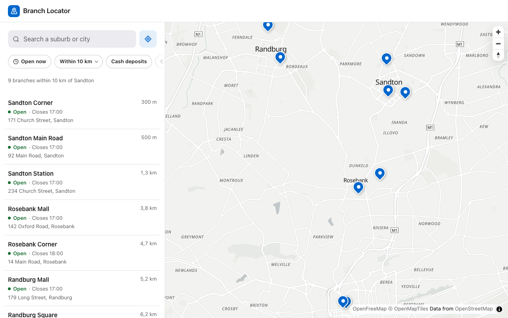 | 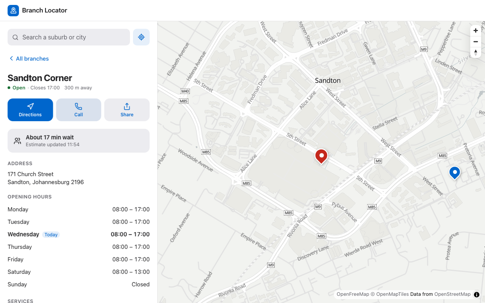 | 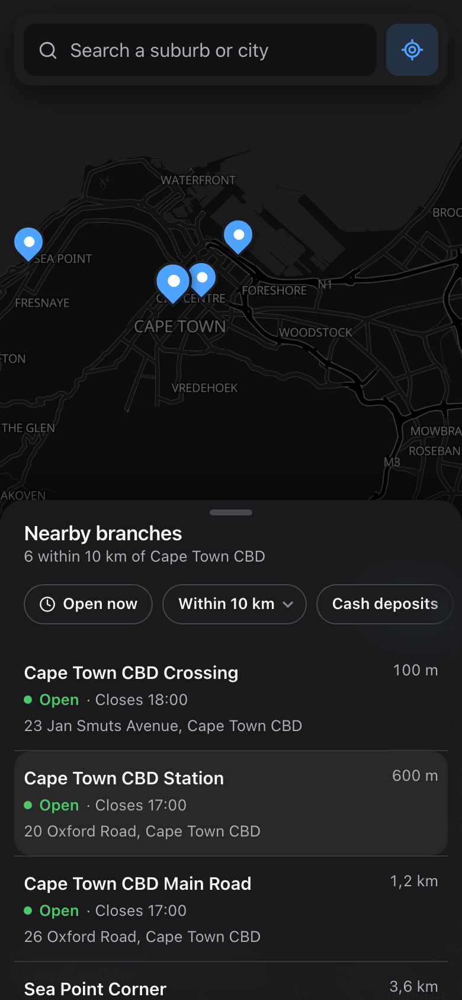 |

---

## Using the app

The app opens on branches near Cape Town CBD, with a list beside the map. Every Capitec location in the mock data is real, so you can search anywhere in South Africa.

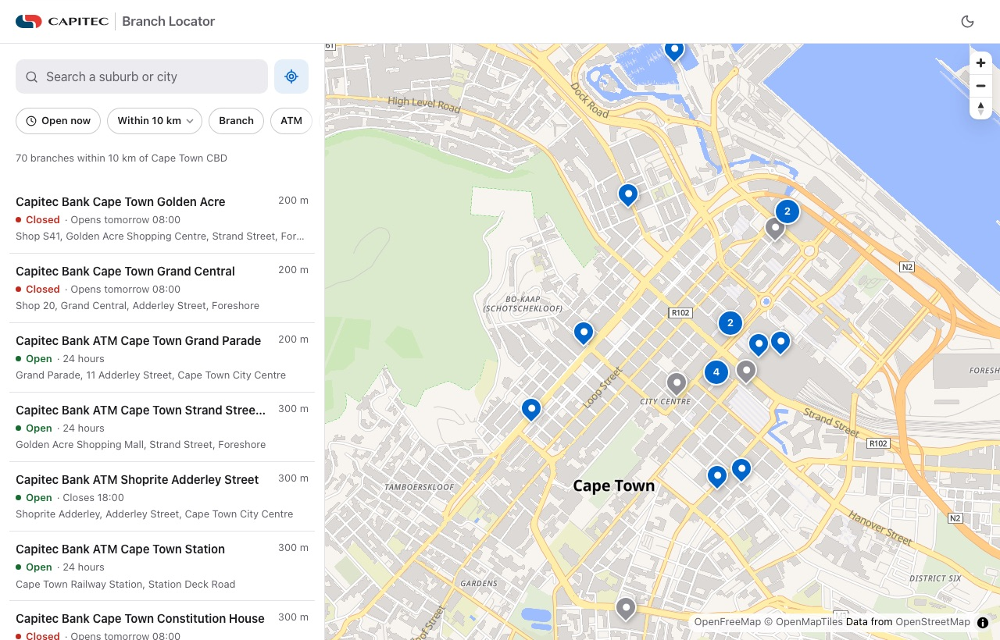

### 1. Search for a place

Type a suburb, town or city into **Search a suburb or city** and pick a suggestion, with the mouse or the arrow keys and Enter. The list and map move to branches around that place.

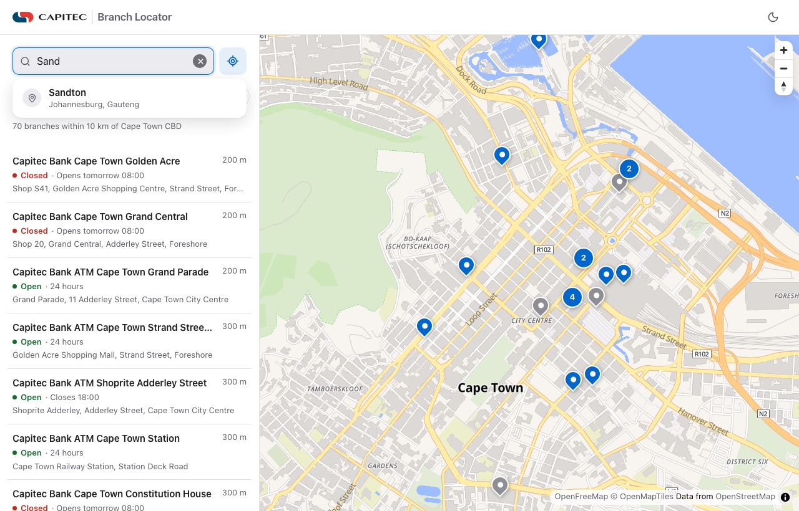

### 2. Or use your location

The target button next to the search finds branches near you. The browser asks for permission first. If you say no, or your location isn't available, a message explains it and search still works.

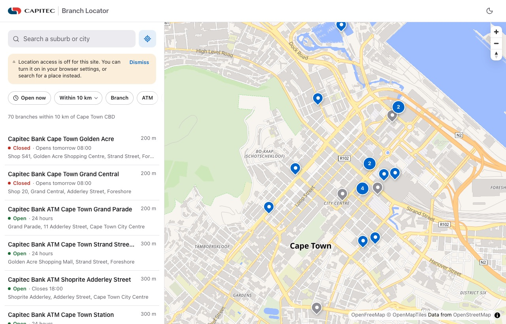

### 3. Filter what you need

Use **Open now**, the distance, and the service chips (Branch, ATM, Cash deposits, Smart ID, Business banking) to narrow the list. If nothing matches, the page says so and offers to clear the filters or search a wider area.

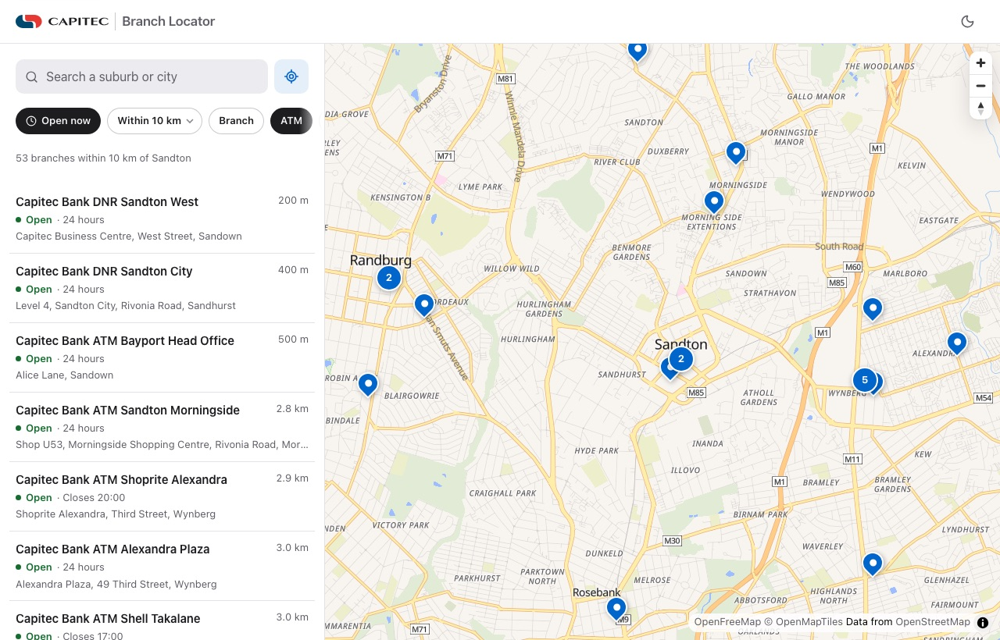

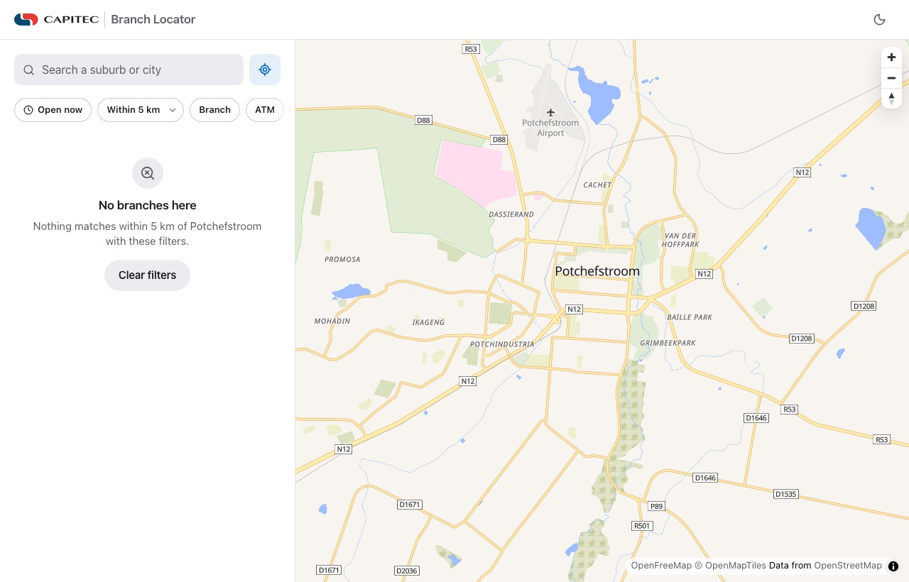

### 4. Read the map

Blue pins are open and grey pins are closed. Where several branches are too close to tell apart, they're grouped into a numbered circle; choose it to zoom in until they separate.

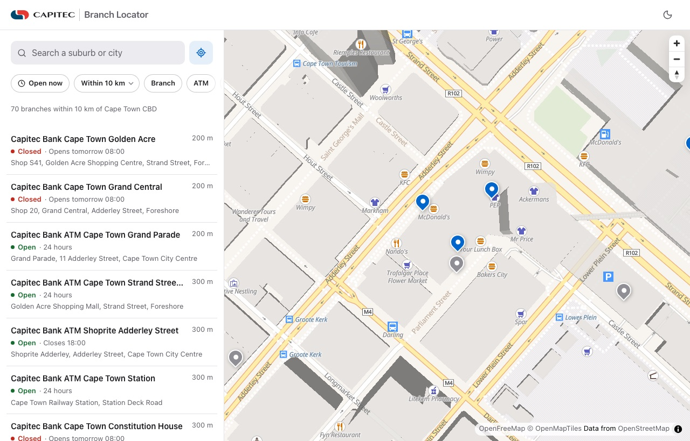

### 5. See a branch

Choose a branch in the list or a pin on the map. You'll see whether it's open, the wait time, its address, opening hours for the week and its services. **Directions** opens your maps app, **Call** rings the branch, and **Share** copies a link that opens straight to it. **All branches** goes back to the list.

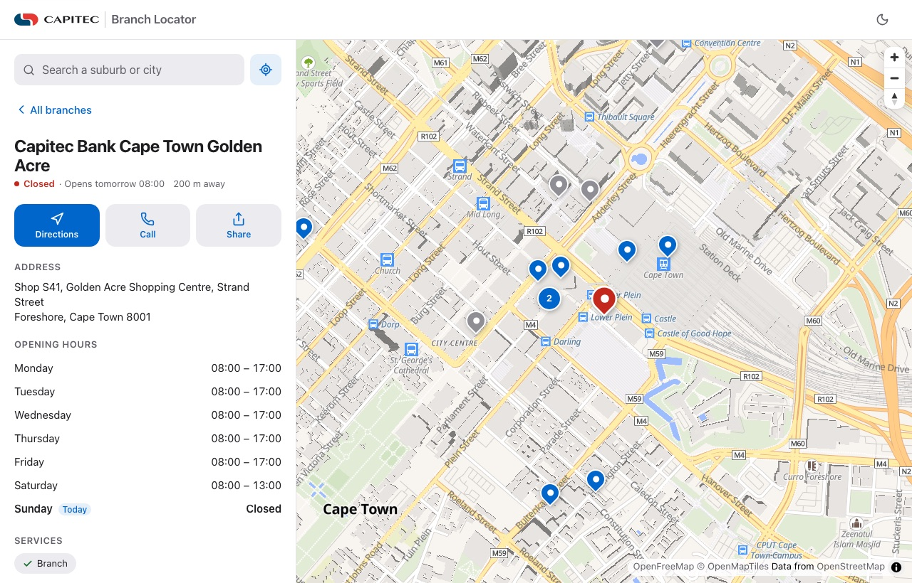

### 6. On a phone

On a phone the map fills the screen and the branches sit in a sheet you can drag up and down. Choosing a branch shows its details in the same sheet.

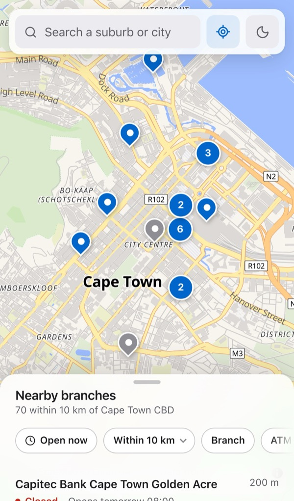 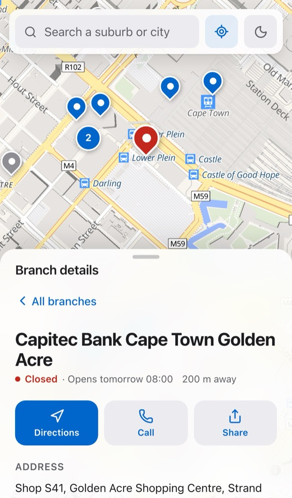

### 7. Light and dark

The moon button switches the whole app, map included, between light and dark.

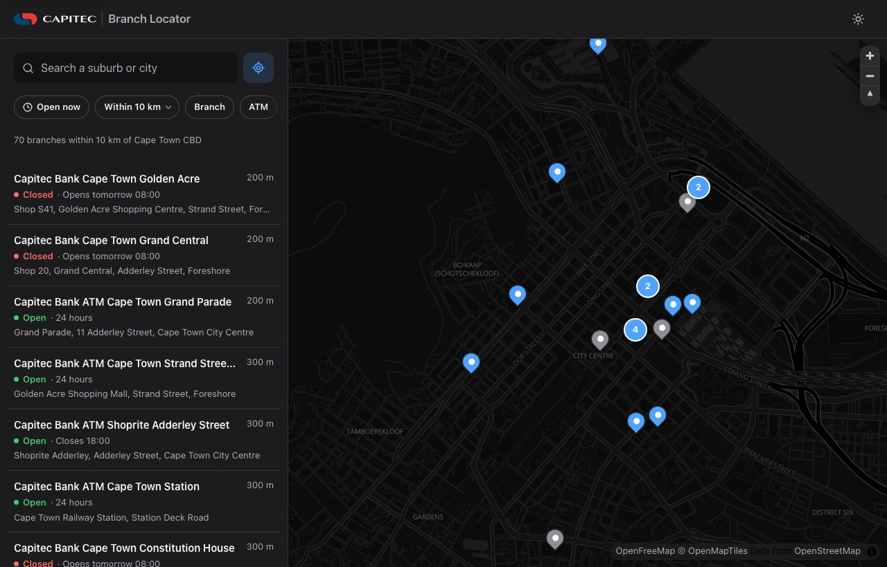

---

## Quick start

### With Docker (recommended)

```bash
docker build -t branch-locator .
docker run --rm -p 8080:8080 branch-locator
# then open http://localhost:8080
```

or `docker compose up --build`.

This is a multi-stage build: `npm ci` from the lockfile, then a Vite production build, then static files served by **unprivileged nginx** on port 8080, with a strict Content-Security-Policy, gzip, immutable caching for hashed assets and a `/healthz` endpoint for the container `HEALTHCHECK`.

Run the full quality gate (format, lint, typecheck, tests) inside Docker:

```bash
docker build --target test .
```

### Locally

Requires **Node.js 22.12+** (Node 24 LTS recommended; see `.nvmrc`).

```bash
npm ci
npm run dev        # http://localhost:5173
```

| Command                              | What it does                                                                                    |
| ------------------------------------ | ----------------------------------------------------------------------------------------------- |
| `npm run dev`                        | Dev server with hot reload and the mock API                                                     |
| `npm run build`                      | Typecheck and build to `dist/`                                                                  |
| `npm run preview`                    | Serve the production build with the production security headers                                 |
| `npm test` / `npm run test:coverage` | Unit, contract and integration tests (Vitest), with coverage thresholds                         |
| `npm run test:e2e`                   | Playwright end-to-end and axe accessibility tests against the production build (real WebGL map) |
| `npm run lint` / `npm run typecheck` | ESLint (type-aware strict, React Hooks, jsx-a11y) with zero warnings / strict `tsc`             |
| `npm run verify`                     | Everything CI runs before building                                                              |

Configuration is set at build time (`--build-arg` in Docker, or `.env.local`):

| Variable                                       | Default                    | Purpose                                                                                             |
| ---------------------------------------------- | -------------------------- | --------------------------------------------------------------------------------------------------- |
| `VITE_API_BASE_URL`                            | _(same origin)_            | Base URL of the Branch Locator API                                                                  |
| `VITE_ENABLE_MOCKS`                            | `true`                     | Serve the API from the in-browser mock. Set to `false` when a real backend exists.                  |
| `VITE_MAP_STYLE_LIGHT` / `VITE_MAP_STYLE_DARK` | OpenFreeMap Liberty / Dark | MapLibre style URLs. If you change the host, update `connect-src` in `nginx/security-headers.conf`. |

---

## The API

[docs/API.md](docs/API.md) defines five endpoints in the same style as the other two briefs:

| Endpoint                                                    | Purpose                                                                     |
| ----------------------------------------------------------- | --------------------------------------------------------------------------- |
| `GET /api/branches?lat&lng&radiusKm&services&openNow&limit` | Branches near a point, sorted by distance, each with its open status        |
| `GET /api/branches/{id}`                                    | Full detail: weekly hours, services, facilities, phone, live queue estimate |
| `GET /api/branches/filters`                                 | Service and facility options, and the radius choices                        |
| `GET /api/places?query`                                     | Suburb and city search, for people who don't share their location           |
| `GET /api/places/{id}`                                      | Restore a searched place from a shared link                                 |

The mock in `src/mocks` implements it in full:

- **Every open Capitec location in South Africa** (about 3,700 branches, ATMs, cash-accepting ATMs and business centres), saved from the store feed behind capitecpages.localpages.io into `src/mocks/data/stores.json`. `npm run sync:stores` refreshes it (see below). Each location's feed attributes become its services: _Branch_, _ATM_, _Cash deposits_ (a cash-accepting ATM), _Smart ID_ and _Business banking_.
- **Readable names:** many feed names end in an internal site code ("Shoprite Belhar 50869", "Spar 3R"). The mock drops those codes for display and keeps the IDs unchanged, so shared links still work.
- **57 real South African suburbs and towns** for the place search.
- **Opening hours** from the feed: branches have their weekday hours and the sync day's hours, and ATMs keep their own hours every day, including 24 hours and until midnight. The feed only gives the sync day's hours for ATMs and business centres, so their other days are assumed. "Open now" and "Opens tomorrow 08:00" are calculated in South African time, so they're correct whatever time zone the device or CI runner is in.
- **A queue estimate** for branches (not ATMs) that's busier at lunchtime and month-end.
- **Validation:** `400` responses for bad coordinates, radius or service, and `404` for unknown IDs.

### Refreshing the store data

```bash
npm run sync:stores
```

This asks the store feed (`admin.goreview.co.za/website/api/locations/search`) for the whole network, checks the response with Zod, and rewrites `src/mocks/data/stores.json` with one store per line, so a re-sync shows up as a readable diff. The mapping lives in `src/mocks/data/storeFeed.ts` and is unit-tested:

- **Closed stores** (temporarily or permanently) are left out.
- **Store types** come from the attributes, or from the feed's brand code for the ~450 stores without attributes.
- **Addresses** are split into street, suburb, city, province and postcode.
- **Hours:** the feed has only the sync day's hours for each store, plus the coming weekdays for branches. ATMs keep the sync day's hours all week. Branch days without hours count as closed, so syncing on a Saturday leaves Sundays closed. Business centres' weekday hours (08:30–16:30) are assumed.

The feed only allows browser requests from capitecpages.localpages.io, so the app can't call it directly. It's also not a published API, so check that you may use it before relying on it in production.

---

## How it works

```
src/
├── api/          Zod contracts, typed fetch client, endpoints, React Query hooks
├── domain/       Pure logic: distances, opening-hours wording, URL state, labels
├── features/
│   ├── locator/  Page, search combobox, filters, list, branch detail, draggable sheet (+ detent physics)
│   └── map/      MapLibre wrapper: pins as buttons, framing, selection, "search this area"
├── hooks/        Geolocation (on request only), media queries, debouncing
├── mocks/        MSW handlers, branch network generator, hours and queue model, place search
└── styles/       Design tokens: light, dark, increased contrast, reduced transparency
```

- **Server state lives in TanStack Query:** debounced place search, cached branch detail, previous results kept on screen while a new search loads, and "open now" refreshed every five minutes.
- **The URL holds what's worth sharing:** the selected branch, a searched place and the filters. A link like `/?branch=br_cape_town_golden_acre` opens straight to that branch and searches around it.
- **The URL never holds the customer's own location.** Coordinates from "Use my location" stay in memory. When they're sent to the API, they're rounded to about 11 m, which is plenty for finding a branch and less precise than the device's fix.
- **The map is loaded lazily.** MapLibre is about 290 kB gzipped, so it streams in separately while the search field and list are already usable.
- **The page and the map are kept apart.** React owns the data; `BranchMap` owns the imperative MapLibre instance: creating it once, syncing pins, framing new results, easing to the selection, and following light and dark appearance. Camera moves made by the app are told apart from the customer's own pans, so "Search this area" only appears when the customer has actually moved the map.

---

## Interaction design

The interaction design borrows from Apple's Human Interface Guidelines, adapted for the web, and the layout is modelled on Apple Maps.

**The sheet on phones.** Results live in a translucent sheet over a full-screen map, with three resting points: _peek_ (just the count), _half_ and _full_.

- **It follows the finger:** dragging the grabber or header moves the sheet with the finger, and it rubber-bands past the top and bottom.
- **A flick carries it:** on release, the sheet projects where the gesture would naturally come to rest (using exponential decay, like native scrolling) and settles at the detent nearest that point. A short, fast flick therefore travels a whole detent.
- **No visible seam:** the release velocity is handed to the spring, which gets a touch of bounce only after a fast flick.
- **It can always be caught:** a sheet still in motion can be grabbed again, because every animation starts from where the sheet actually is.
- **It doesn't block:** there's no scrim, so the map stays usable underneath.
- **It works without dragging:** the grabber is also a button (_Expand / Collapse results_) with `aria-expanded`, for keyboard and switch users.

**Navigation.** Opening a branch pushes a detail view in from the right; "All branches" or the browser's back button returns the same way, like a navigation stack. Focus moves to the branch name on arrival and back to the list on return.

**Feedback.**

- Pins that would overlap are grouped into one numbered button ("4 branches here"), and choosing it zooms in until they separate. The selected branch is never hidden in a group, and from street level every pin shows on its own.
- Pins grow from their tip on hover, and the selected pin turns red and lifts above the others. Hovering a list row highlights its pin, and hovering a pin highlights its row.
- Every control responds when pressed, not on release.
- Open or closed status is always written out ("Open · Closes 17:00", "Closed · Opens tomorrow 08:00"), never shown by colour alone.

**Respect for the customer.**

- **Permission only when asked:** location permission is requested only when "Use my location" is tapped, never on page load. If it's refused, a plain-language message explains how to turn it on, or to search instead.
- **Searching is always an alternative,** so nobody is forced to share their location.

**Empty and error states that help.**

- **No results:** shows _Clear filters_ when filters are what's narrowing the search, or _Search a wider area_ otherwise.
- **Failed requests:** each failure gets a retry.

**Materials and motion.**

- **Translucent surfaces:** the floating search and the sheet use `backdrop-filter`, falling back to solid surfaces under `prefers-reduced-transparency`.
- **Springs:** critically damped (no bounce) by default.
- **Reduced motion:** `prefers-reduced-motion` turns movement into fades and camera moves into instant jumps.
- **Dark mode:** the map switches styles to match light and dark appearance.

---

## Accessibility

- **The place search is a WAI-ARIA 1.2 combobox:** arrow keys move through suggestions, Enter picks, and Escape closes and then clears. The active option is announced with `aria-activedescendant`.
- **Map pins are real `<button>`s**, labelled "Name, open" or "Name, closed" and marked `aria-pressed` when selected. They can be reached with Tab and activated with Enter. The map canvas also supports MapLibre's own keyboard panning and zooming.
- **Status is announced:** result counts and share confirmations use `aria-live`.
- **Every view has proper landmarks and headings,** and the hours table marks today.
- **axe scans** pass WCAG 2.1 AA in light and dark mode on desktop and on a phone profile. The map canvas is excluded because its labels are drawn by the tile style, not the DOM.

---

## Security

- **Strict Content-Security-Policy:** no `unsafe-inline` or `unsafe-eval`, and no `blob:` workers. MapLibre's web worker is served from our own origin via `setWorkerUrl`. `connect-src` allows only the map tile host.
- **No injected styles:** the CSP check caught Motion's `popLayout` mode injecting a `<style>` tag, so the list-to-detail transition uses `mode="wait"` instead. Zod is configured `jitless`, so it never probes for `eval`.
- **Location access limited to this site:** `Permissions-Policy` allows geolocation for this origin only (`geolocation=(self)`) and turns off camera, microphone, payment and USB.
- **Pins are built safely:** pins and markers are created with DOM APIs. Branch data never passes through `innerHTML`.
- **Hardened container:** a non-root nginx container, compatible with `--read-only`, and `npm ci --ignore-scripts` in Docker and CI.

---

## Testing

| Layer           | What it covers                                                                                                                                                                                                                                                                                                                                                                                                                                                                          |
| --------------- | --------------------------------------------------------------------------------------------------------------------------------------------------------------------------------------------------------------------------------------------------------------------------------------------------------------------------------------------------------------------------------------------------------------------------------------------------------------------------------------- |
| **Unit**        | Distances and their formatting; open/closed wording ("tomorrow", weekday names); opening-hours logic across closing time, Saturday afternoons and closed Sundays; closing at midnight and ATMs open 24 hours; queue model; the store-feed mapping (addresses, store types, 12-hour times, weekly hours, closed stores dropped, unique IDs); place-search ranking (prefix, accent and case-insensitive, city and province); detent physics (a flick carries a whole detent); URL state.  |
| **Contract**    | Every endpoint in `docs/API.md` returns data that parses with the app's Zod schemas, with the documented `400` and `404` responses.                                                                                                                                                                                                                                                                                                                                                     |
| **Integration** | The real route tree in jsdom with React Testing Library and MSW, with the WebGL map swapped for a small fake that exposes the same callbacks. Covers the default results, the keyboard combobox, selecting from the list and from a pin, focus moving into the detail and back, filters in the URL, widening an empty search, geolocation allowed (and kept out of the URL) and refused, "Search this area", shared branch links, the phone sheet, and recovering from a failed search. |
| **End-to-end**  | Playwright on desktop Chrome, desktop Safari and a Pixel 7 profile, against the production build with the **real MapLibre map** and the production CSP. Covers tapping a pin, place search, granted geolocation (and that the URL never contains coordinates), shared links, the phone sheet, and axe scans in light and dark mode. Any console error, including a CSP violation, fails the run.                                                                                        |

Current results: **95 unit/contract/integration tests** and **23 e2e tests** (plus four skipped by design because they only apply to phones or to desktops). Coverage is ~90% of lines and ~81% of branches, with thresholds enforced. The WebGL map component is excluded from unit coverage because Playwright covers it.

**What the end-to-end suite caught.** Three problems only showed up with a real browser, map and security headers:

1. `Permissions-Policy: geolocation=()` (copied from a stricter default) silently blocked "Use my location". It's now `geolocation=(self)`.
2. Switching places briefly unmounted the map, and a listener cleanup then ran against the removed map. Places now keep their previous value while loading, and every cleanup checks that the map still exists.
3. Map tile requests made through the mock service worker are governed by `connect-src`, not `img-src`.

---

## Decisions and trade-offs

**MapLibre GL with OpenFreeMap, not Leaflet with raster tiles.**
I started with Leaflet and CARTO tiles. CARTO now returns an "API key required" watermark, and OpenStreetMap's volunteer tile servers block apps under their usage policy. OpenFreeMap serves vector tiles with **no key and no usage limits**, and MapLibre renders them on the GPU, giving the fluid zoom, rotation and crisp labels people expect from Apple Maps. The cost is bundle size, which lazy-loading keeps off the critical path.

**A non-modal sheet on phones, a side panel on desktop.**
Phones get the Apple Maps pattern: the map is the context and the sheet is a parallel layer, so there's no dimming. Desktop has room for both, so the list sits beside the map and the sheet isn't needed.

**The location stays out of the URL.**
A link to a place or a branch can be shared; a link containing someone's coordinates shouldn't exist. Refreshing after "Use my location" returns to the default area, which is a deliberate trade-off for privacy.

**Cape Town CBD as the starting area.**
The page shows real results immediately, instead of an empty map waiting for permission. The customer can switch to their own location in one tap.

**`mode="wait"` page transitions.**
Overlapping list and detail transitions (`popLayout`) would need an inline `<style>`, which the CSP forbids. A quick 120 ms exit followed by a spring entrance keeps the stack-like feel.

---

## What I'd do next

- **Server-side clustering, or vector-tile pins,** if the network grew to thousands of branches.
- **Real queue data** from the branch system, plus booking a slot.
- **Public holidays** in the opening-hours model.
- **Offline support** (a service worker and a cached branch list) for patchy mobile connections.
- **Runtime config** (`/config.json`) so one Docker image can be promoted across environments.
